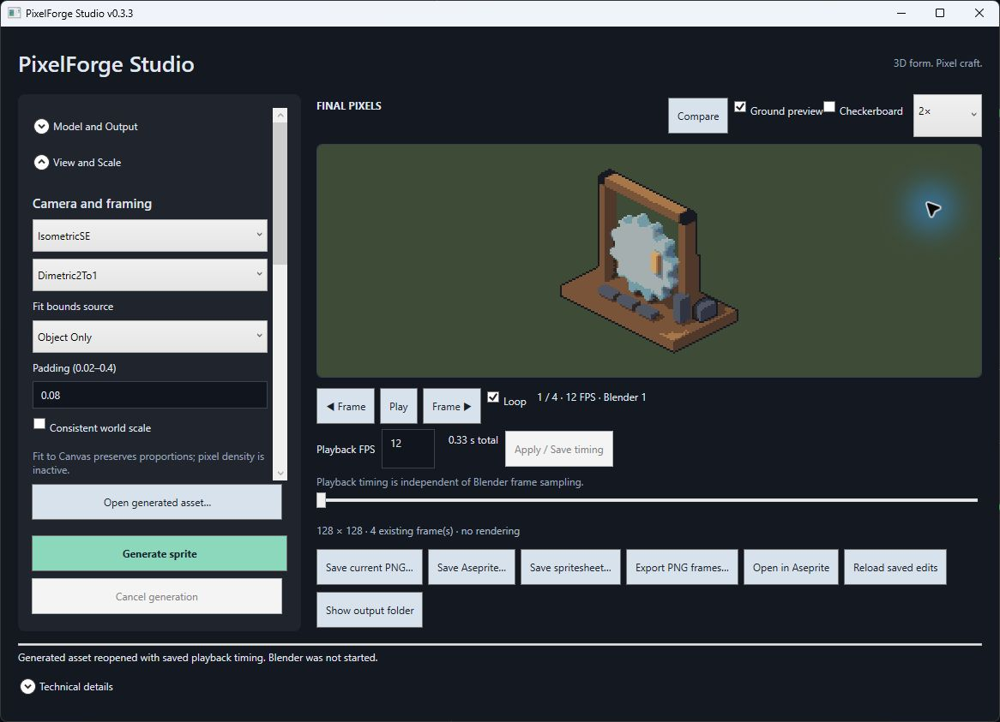
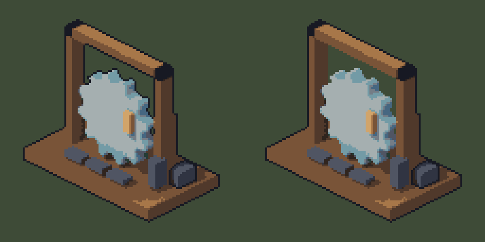
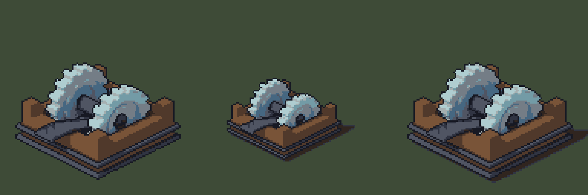

# PixelForge Studio

**3D Form. Pixel Craft.**

A native Windows tool for converting Blender models and animations into palette-constrained, editable pixel-art sprites.

## What is PixelForge Studio?

PixelForge samples evaluated 3D geometry with a fixed studio camera, converts the visible result onto a strict pixel grid, and builds layered Aseprite documents alongside PNG sprites and spritesheets.

**3D model → PixelForge → PNG / Aseprite / spritesheet → game engine**

It complements Blender and Aseprite: model and animate in Blender, generate a consistent starting sprite, then make deliberate pixel edits in Aseprite.

## Features

- **Blender conversion:** evaluated transforms, parenting, constraints, armatures and ordinary mesh modifiers; source files are never saved over.
- **Camera and scale:** four isometric directions, orthographic cardinal/top/bottom views, 2:1 dimetric or true-isometric projection, Fit to Canvas or fixed pixels per world unit.
- **Palettes and resolution:** approved colors from GPL/JASC PAL, PNG swatches, native Aseprite palettes or HEX/RGB lists; arbitrary 1–2048 pixel dimensions and six square presets.
- **Lighting and shadows:** studio light direction/intensity, ambient fill, surface shadows and optional palette-stepped ground shadows with binary transparency.
- **Outlines and highlights:** one/two-pixel contours, visible components, optional selective outlines and light-facing edge accents using evaluated geometry.
- **Collection-aware outlines:** `PF_Outline_…` collections share contours without joining meshes or merging their editable component layers.
- **Animation:** sampled Blender frames, editable native cels/tags, preview stepping/playback and independently editable playback FPS. Speed changes do not render frames again.
- **Exports and cleanup:** PNG, Aseprite, fixed-grid spritesheet PNG/JSON and ordered PNG frames with timing metadata. Reload saved Aseprite edits explicitly.
- **History and comparison:** four recent successful renders plus favorites; aligned reveal-divider or side-by-side comparison using saved frames, shared zoom and independent animation frame selection.
- **Precise controls:** switch applicable sliders to numeric entry; readable formatting and UI input modes stay separate from precise rendering parameters.

## What's new in v0.3.3

- **Object Only fit bounds** keep the machine's scale and position stable when ground shadows, softness, strength or light direction change. Shadow-inclusive fit remains an explicit advanced choice.
- **Unified grouped outlines** reduce heavy internal contours, keeping the shared machine exterior and original transparent gaps. Conservative mode retains the earlier group contours.
- Publication preparation includes a concise version history, targeted ignore rules, reproducible fixture sources and selected documentation images. No license or public repository URL is assumed.

See [CHANGELOG.md](CHANGELOG.md) for the development history. Technical validation is not artistic approval; inspect sprites at their intended game resolution.

## Screenshots and examples



**Grouped outlines — Conservative (left), Unified (right):**



**Shadow fit — shadow off, previous shadow-inclusive fit, Object Only with shadow:**



Examples are actual generated sprites. Green in comparison sheets is a presentation background, not an extra sprite palette color. The animated machine is a reproducible test fixture; it is not production game artwork.

## Technologies

| Technology | Role |
|---|---|
| C# / .NET 10 | Settings, deterministic pixel conversion, validation, timing and exports |
| WPF | Native Windows interface and nearest-neighbor previews |
| Blender Python / Cycles | Disposable evaluated-geometry studio, visible masks and optional surface data |
| Aseprite Lua / CLI | Editable layered animations, native-composite verification and saved-edit reload |
| PowerShell | Build and self-contained Windows publishing |
| Git | Optional source version control and the publication workflow below |

There are no third-party NuGet packages or separate Python/pip dependencies. Aseprite Lua scripts are generated by the C# export/reload code; Blender bridge scripts are in `bridge/`.

## Getting started

1. Use a portable package supplied by the project owner, or build from source below. No public download/release URL is declared yet.
2. Extract/keep the entire published folder together and launch **PixelForge.Desktop.exe**, or use **Launch.bat** in a source workspace after publishing.
3. Browse to a trusted `.blend` model, choose a palette, resolution and view, then press **Generate sprite**.
4. Review the final pixels, motion and warnings. Use **Save current PNG**, **Save Aseprite**, **Save spritesheet** or **Export PNG frames**.
5. Optionally open the native animation in Aseprite, save manual corrections, and use **Reload saved edits** to refresh PNG previews/exports.

Every generation writes a separate output folder. Keep its settings, native file, frames and metadata together. Existing generated or edited artwork is never replaced by generating another asset.

### Grouping and fit

Organize members in Blender collections such as `PF_Outline_Machine`, including nested collections, then enable **Respect Blender Outline Groups**. **Unified** is the group-mode default: it classifies the combined exterior, suppressing enclosed/narrow internal contours without filling sprite pixels. Major open gaps, materials, highlights and component layers remain readable. **Conservative** keeps v0.3.2's group contours. Ambiguous memberships choose the deepest named collection, then the lexicographically first full path, with a warning and exported mapping. Grouping is disabled by default for ordinary assets.

Under View and Scale, **Fit Bounds Source → Object Only** fits visible model geometry over the selected motion, excluding the ground shadow. Shadows may clip at canvas edges; warnings explain this. **Object + Ground Shadow** deliberately includes shadow space and can make the object smaller. Fixed-density mode still requires sufficient canvas space.

### Playback timing and numeric entry

Frame sampling selects which Blender frames are generated. Playback FPS, beside Play/Pause, changes cached-frame speed immediately; **Apply / Save timing** persists distributed integer-millisecond durations without modifying pixels. Save and close external Aseprite documents first: unsaved external edits cannot be detected. Timing updates use the latest saved native file and keep backups; reopen Aseprite afterward.

Numeric controls apply on Enter or focus loss; Escape restores the last valid value. Fractional entries allow up to two decimal places; percentage strengths use whole percentages. Display formatting and mode switches do not round untouched saved/slider values or start rendering. Width, height, frames and FPS remain ordinary integer fields.

## Requirements

- **Runtime platform:** Windows x64. Published self-contained builds include the .NET desktop runtime; a separate SDK/runtime installation is not required to run them.
- **Generating assets:** existing Blender and Aseprite installations with their Python/Lua CLI support. Verified versions are Blender 5.3.0 and Aseprite 1.3.18.6; external tools are not bundled.
- **Saved comparison and FPS editing:** operate from existing output files without starting Blender/Aseprite.
- **Building:** a Windows .NET 10 SDK, PowerShell and initially available Microsoft framework/runtime packs. Git is needed only for cloning/version control. Initial restore/publishing may require internet access.

Steam tool paths are discovered automatically. For other installations set full executable paths in `PIXELFORGE_BLENDER` and `PIXELFORGE_ASEPRITE`. `PIXELFORGE_OUTPUT` changes the initial generation folder; `PIXELFORGE_PROFILE` selects an isolated UI/history profile. Defaults live under Documents and `%LOCALAPPDATA%/PixelForgeStudio/`.

## Building from source

After a repository has been published, replace the placeholder with its real URL:

```powershell
git clone <YOUR_REPOSITORY_URL> PixelForgeStudio
Set-Location PixelForgeStudio
./Build.ps1 -Check
./Build.ps1 -Publish
./Launch.bat
```

The publish output is `app-v0.3.3/`. Close that build before republishing it; keep the whole folder together. The script uses `.tools/dotnet/dotnet.exe` if locally installed, otherwise `dotnet` on PATH. The local SDK is optional and is not part of the source repository.

To run the desktop from source or execute focused checks with an installed SDK:

```powershell
dotnet run -c Release --project src/PixelForge.Desktop
dotnet run -c Release --project src/PixelForge.Checks -- --v033 - outputs/v033
```

The first command runs the app. The second generates its own animated fixture and exercises grouping, fit, directions, native output and persistence using real Blender/Aseprite. Replace `-` with a model path to add the mine/model framing comparison. Base `Build.ps1 -Check` does not require external tools.

v0.3.3 verification passed 239 grouping/framing checks, 68 usability checks, 69 playback-timing checks and 25 base checks. A fresh source-only copy also built with zero warnings and passed its base checks. Real comparison images above were visually inspected; these results cover the tested fixtures, not every possible Blender model.

Other focused suites include `--usability <model.blend> <animated-fixture.blend> <output-folder>` and `--timing <existing-12-frame-output> <output-folder>`. Generate an animation fixture first with Blender and `tests/create_animated_fixture.py -- <output.blend>`. Legacy compiled comparisons are optional via `PIXELFORGE_LEGACY_CORE`; no old executable/output folder is required for normal source builds or base checks.

## Project structure

| Path | Contents |
|---|---|
| `src/PixelForge.Core/` | Conversion, palettes, masks, outlines, timing, exports and external-tool orchestration |
| `src/PixelForge.Desktop/` | WPF window, comparison and numeric controls |
| `src/PixelForge.Checks/` | Dependency-free base and real integration checks |
| `bridge/` | Blender worker and read-only geometry/collection helpers |
| `tests/` | Procedural Blender fixture generators; generated `.blend` files stay local |
| `examples/` | Intentional starter palette resource |
| `docs/images/` | Small, selected application/sprite documentation images |
| `Build.ps1`, `Launch.bat` | Build/publish and launch entry points |

## Troubleshooting

- **Missing Blender/Aseprite:** check executable locations and the override environment variables. Both are required for complete generation/native verification.
- **Failed or canceled render:** inspect the generated folder's tool logs and UI Technical details. Failed/incomplete outputs do not enter successful-render history.
- **Unexpected framing:** choose Object Only for stable shadow-independent fitting. Fixed density can report required dimensions rather than silently rescale.
- **Little visible softness:** ground lighting, contact geometry, resolution and available dark palette steps limit binary-alpha penumbras. Warnings report missing contrast or single-shade quantization.
- **Collections not recognized:** use the exact `PF_Outline_` prefix and enable the group option. Collection instances remain unsupported; realize instances in a separate model copy.
- **External edits missing from PNG:** save Aseprite, then Reload saved edits. Timing alone intentionally preserves rather than imports pixel edits.
- **Unsupported sources:** arbitrary linked/procedural shaders use explicit fallback colors; uncached simulations and complex external dependencies are not guaranteed. Open trusted models; disabling embedded auto-run scripts is not an OS sandbox.
- **Restore warning NU1900:** the package vulnerability feed was unavailable. Review network access; the warning does not establish a vulnerability or add a runtime dependency.

Animation limits remain 1–256 frames, 16 million total output pixels and 8192-pixel spritesheet dimensions. Keep palette membership and binary alpha when manually editing exported frames.

## Publishing the source to GitHub

No repository is created, remote changed, or code pushed automatically. If a remote already has history, clone it first and copy the prepared source into that checkout; review/merge its existing files rather than overwrite its `.git` directory or force-push.

For a local folder, run these only when you choose to initialize/commit:

```powershell
if (!(Test-Path .git)) { git init }
git status --short
git add .gitignore AGENTS.md README.md CHANGELOG.md Directory.Build.props PixelForgeStudio.sln Build.ps1 Launch.bat "Run PixelForge.cmd" src bridge tests docs examples
git diff --cached --stat
git commit -m "Prepare PixelForge Studio v0.3.3"
git status --short

git remote -v
# Only if origin does NOT already exist:
git remote add origin <YOUR_EXISTING_GITHUB_REPOSITORY_URL>
git branch --show-current
git push -u origin HEAD
```

Keep an existing remote/branch intact. Review ignored files with `git status --short --ignored`; never add SDK downloads, private RenderSettings, generated output, credentials or published executables. The targeted ignore rules leave intentional PNG/Blender assets eligible for tracking; current fixture binaries are reproducibly generated from tracked scripts.

## License

A project license has not been selected. No MIT or other license is assumed or copied from EasierCpp. Add an owner-approved `LICENSE` before presenting PixelForge as licensed open-source software. Blender, Aseprite and Microsoft components retain their own terms.

## Contributions and feedback

After the owner publishes a repository, use its actual issue tracker and contribution workflow. Include the app version, minimal reproduction, expected/actual behavior and sanitized logs; remove private paths and model data. No repository or issue URL is invented here.
