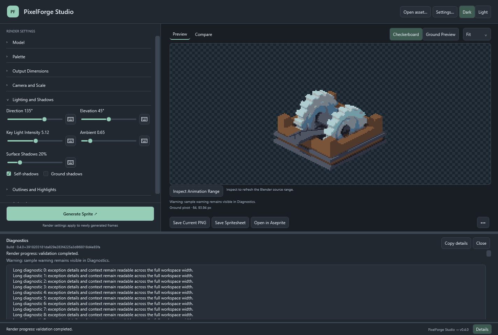
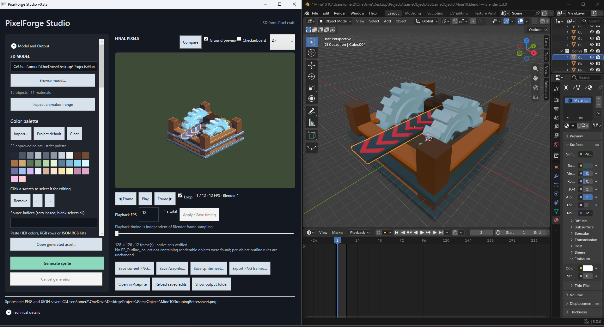

# PixelForge Studio

**3D Form. Pixel Craft.**

A Windows desktop application that transforms Blender models and animations into palette-constrained pixel-art sprites, with editable Aseprite layers and game-ready PNG exports.

## Features

- Static and animated Blender conversion with orthographic/isometric views and consistent framing.
- Custom palettes and resolutions, studio lighting, surface shadows and optional ground shadows.
- Object and collection-aware outlines, selective outlines and light-facing edge highlights.
- Editable layered Aseprite documents, PNG frames and spritesheet PNG/JSON exports.
- Immediate playback-FPS changes without rendering again; saved timing preserves pixel edits.
- Saved preferences, numeric controls, resolution presets and read-only render comparison.
- Temporary render sessions, permanently preserved favorites, separate last-used directories and compact color management.

Paste batches into **Add Colors (HEX / RGB)** under Manage Colors; HEX separators may be semicolons, newlines or whitespace. **Source Color Indices** is a separate advanced numeric-only field. **Details** opens resizable full-width diagnostics with Copy details. Independent file-dialog folders and theme preferences are saved in the user application-data directory.

See [CHANGELOG.md](CHANGELOG.md) for version history.

## Screenshots



[Light theme screenshot](docs/images/ui-light.png). Switch themes in the header; settings and cached artwork stay in place.

Conservative grouped outlines (left) and Unified (right):


Shadow off, shadow-inclusive fit, and stable Object Only fit:


These are real application/generated examples. Green is the preview background, not an added sprite color.

Blender to Pixel conversion looks like this.


More examples: [animated comparison](docs/images/grouping.gif) · [sprite PNG](docs/images/mine.png).

## Technologies

C# · .NET 10 · WPF · Blender Python/Cycles · Aseprite Lua/CLI · PowerShell

The original source uses no third-party NuGet packages. External tools remain separate installations.

## Getting Started

1. Obtain a Windows x64 portable ZIP from [GitHub Releases](https://github.com/Omerio571/PixelForgeStudio/releases). This source tree prepares v0.4.0; its ZIP becomes available there only after publication.
2. Extract the **entire ZIP** into a writable folder and run **PixelForge Studio.exe** or **Launch PixelForge.cmd**.
3. Install Blender and Aseprite for generation. Steam installations are detected automatically; see [tool configuration](docs/USAGE.md#external-tools) for other locations.
4. Choose a trusted `.blend` model, palette, resolution and view, then select **Generate sprite**. Renders stay temporary: use **Save Current PNG**, **Save Spritesheet**, or preserve the editable render/favorite to keep it. Opening Aseprite first preserves its working document.

Requires **Windows x64**. The application and .NET desktop runtime are bundled in one EXE; keep its external `bridge/` scripts alongside it. Native runtime components extract to the standard .NET cache at startup. No SDK is needed to run it. Blender 5.3.0 and Aseprite 1.3.18.6 were verified. Neither tool is bundled. Saved-frame comparison and timing changes work without launching either tool.

See the [usage guide](docs/USAGE.md) for grouping, framing, manual edits and limitations, and [release notes](docs/release/v0.4.0.md) for this version.

In **Camera and Scale**, choose the view type, direction and perspective. Top-Down 3/4 defaults to 60° and accepts 40–85°. In Direct Top and Direct Bottom, the direction points toward the top of the image. In tilted and side views, it identifies the side from which the camera looks. East is +X, north is +Y and up is +Z. Older settings retain their original render orientation.

**Render All Directions** shares framing across all four directions and all sampled frames. Select a rendered direction to preview it or edit its playback FPS. **Save Directional Batch** creates a new folder with direction-suffixed PNG frame sets, sheets, JSON and editable Aseprite documents. Ground shadows are omitted when the camera or light is too low to project onto the visible ground.

## Building from Source

Install the **Windows .NET 10 SDK** and use PowerShell in the cloned/extracted source folder:

```powershell
./Build.ps1 -Check
./Build.ps1 -Publish
./Launch.bat
```

Publishing creates the stable `artifacts/current/` folder. The source-root launcher opens that build; close it before republishing. Changed or added files in a previous current build block replacement until you preserve them. The script uses `dotnet` on PATH, or an optional local SDK in `.tools/dotnet/`. Initial restore/publishing can require internet access. Base checks need no Blender/Aseprite.

`./Build.ps1 -Check -Package` builds the self-contained ZIP in `artifacts/releases/`. See [release preparation](docs/release/PREPARING.md) for integration checks, packaging and review/commit/tag commands.

## License

Original PixelForge source is licensed under the [MIT License](LICENSE). External software retains its own licenses; see [third-party notices](THIRD_PARTY_NOTICES.md).

## Contributions

Use the project's issue tracker or pull requests once its GitHub repository is published. Include the app version, reproduction steps and sanitized logs. Keep changes focused and run `./Build.ps1 -Check`.
